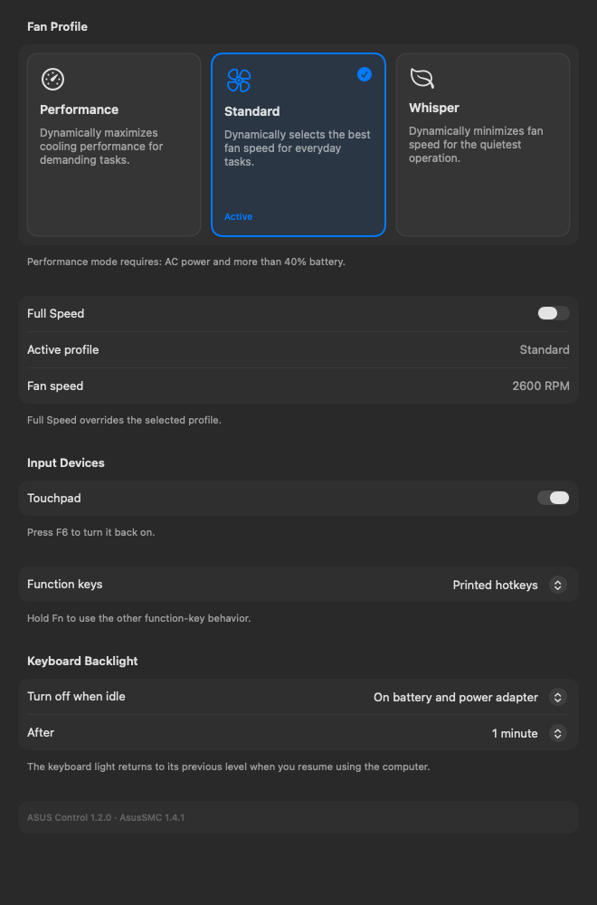

# ASUS Control

ASUS laptop controls, right in **macOS System Settings**.

Choose a cooling profile, check fan speed, switch function-key behavior and
manage your touchpad and keyboard backlight from one native preference pane.



[](https://github.com/samuelnotfound/Asus-X1605VA-Hackintosh-Tahoe/actions/workflows/asus-control.yml)

## Features

| Control | What it does |
| --- | --- |
| **Performance · Standard · Whisper** | Choose how firmware balances cooling and fan noise. |
| **Full Speed** | Override the selected profile while connected to AC power. |
| **Live fan speed** | View the current RPM. |
| **Touchpad** | Enable or disable it, with a shortcut reminder to turn it back on. |
| **Function keys** | Choose printed hotkeys or F1–F12 as the primary action. |
| **Keyboard backlight** | Turn the light off after inactivity and restore it when you return. |

Performance requires **AC power and more than 40% battery**. It returns to
Standard after a restart, unplugging, or a drop below 40%. Select Performance
again when needed. Firmware regulates fan speed within each profile.

## Compatibility

- **ASUS Vivobook X1605VA, BIOS 305**.
- macOS Tahoe with the extended **AsusSMC**, **Lilu** and **VirtualSMC**.
- The existing keyboard-backlight ACPI interface and supported **VoodooI2C**
  driver are needed for backlight timeout and touchpad control.

## Build and install

Install Apple's Command Line Tools, then run:

```sh
git clone https://github.com/samuelnotfound/Asus-X1605VA-Hackintosh-Tahoe.git
cd Asus-X1605VA-Hackintosh-Tahoe/Projects/ASUS/AsusControl
bash build.sh
open "build/ASUS Control.prefPane"
```

Open **System Settings → ASUS Control**. When you save a setting that needs to
stay active, the pane sets up its login helper. You can close System Settings;
the helper continues handling fan policies and the keyboard-light timeout.

To update, pull the latest source, close System Settings, rebuild and open the
new pane. Existing custom API 2 AsusSMC drivers are compatible.

Need the extended driver? Run `bash build-driver.sh`; the output is
`build/AsusSMC.kext`. Replace the existing AsusSMC bundle in your test EFI,
keeping Lilu and VirtualSMC before it. The new driver needs no custom fan or
settings boot arguments. Building the pane does not change your EFI.

## Remove

Run the bundled utility before deleting the pane:

```sh
"$HOME/Library/PreferencePanes/ASUS Control.prefPane/Contents/Helpers/asusctl" service remove
```

For an all-users installation, use `/Library/PreferencePanes` instead. Then
delete the pane. Its settings are in `~/Library/Application Support/AsusControl`.

## Versioning

[VERSION](VERSION) is the release version for the **pane, CLI and login helper**.
AsusSMC keeps its upstream version; [Driver/Upstream.json](Driver/Upstream.json)
pins the driver source and interface revision. The app and driver numbers do
not need to match.

[Developer guide](DEVELOPMENT.md) · [AsusSMC](https://github.com/hieplpvip/AsusSMC)

[License](LICENSE) · [Credits](../../../docs/CREDITS.md)
