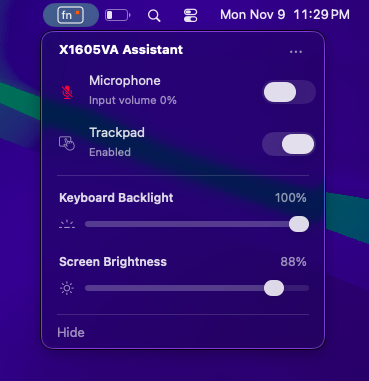

# X1605VA Assistant

> **Deprecated:** This project is no longer actively maintained. It is kept
> available for existing installations.


A native macOS menu-bar utility for the **ASUS Vivobook X1605VA**. It connects
the laptop's ACPI hotkeys and custom kernel extension to a small set of
macOS controls.

## What it provides

- **Microphone:** Fn+F9 mute/unmute with input gain control.
- **Keyboard:** keyboard backlight control from the menu.
- **Trackpad:** Fn+F6 toggle with the current state shown in the menu.
- **Display:** screen brightness through
  [XeShim](https://github.com/JulioNectar/Hackintosh-XPS13Plus-IrisXe-Tahoe/tree/main/tools/XeShim).
- **Shortcuts:** screenshot, forward delete, and menu-toggle key bindings.

The brightness slider uses the same 1-100% scale as
[`xe-brilho`](https://github.com/JulioNectar/Hackintosh-XPS13Plus-IrisXe-Tahoe/blob/main/tools/xe-brilho.m).
Brightness is applied when the slider is released.

## Menu



## Requirements

- ASUS Vivobook X1605VA
- macOS with Xcode Command Line Tools
- `iasl`
- [MacKernelSDK](https://github.com/acidanthera/MacKernelSDK)
- OpenCore configuration access

This project is hardware-specific. Do not install its ACPI table or kext on
another laptop without reviewing the source and device paths.

## Build

Run these commands from this directory:

```sh
export MAC_KERNEL_SDK=/path/to/MacKernelSDK
export IASL=iasl
./build.sh
```

The build creates:

- `build/X1605VA Assistant.app`
- `build/X1605VAAssistant.kext`
- `build/ledctl`
- `build/ACPI/SSDT-X1605VA-Assistant.aml`
- `build/EFI/OC/`, ready to copy into an OpenCore EFI

## Installation

### Build from source

1. Build the project using the commands above.
2. Copy `build/X1605VA Assistant.app` to `/Applications`.
3. Copy the kext from `build/EFI/OC/Kexts/` to `EFI/OC/Kexts/`.
4. Copy `build/EFI/OC/ACPI/SSDT-X1605VA-Assistant.aml` to
   `EFI/OC/ACPI/`.
5. Enable the kext and SSDT in `config.plist`.
6. Reboot through the updated OpenCore EFI and launch the app.

### Installer

The [installer guide](Downloads/) builds and installs the latest published
version from Terminal. Run it as a normal macOS user, not with `sudo`.

When the app reports **Accessibility: Not Granted**, open System Settings and
allow the installed application under **Privacy & Security → Accessibility**.

## Keyboard shortcuts

| Key | macOS action |
| :--- | :--- |
| Fn+F9 / microphone key | Mute microphone (input volume 0%) / unmute (100%) |
| Fn+F6 | Trackpad toggle via ACPI/AsusSMC; the menu follows the driver state |
| Fn+F11 | Select an area to capture (**⌘⇧4**) |
| PrtSc | Capture the entire screen (**⌘⇧3**) |
| Delete | Forward delete in text; **⌘⌫** (Move to Trash) for selected Finder items |
| Backspace | Normal backward delete |
| Fn+F12 / MyASUS key | Open or close the helper's menu while it is running |
| Insert | — |

## OpenCore components

The app requires both components below:

| Component | Location | Purpose |
| :--- | :--- | :--- |
| `X1605VAAssistant.kext` | `EFI/OC/Kexts/` | Provides the userspace bridge for hardware controls. |
| `SSDT-X1605VA-Assistant.aml` | `EFI/OC/ACPI/` | Routes the laptop hotkeys and exposes command endpoints. |

Keep the kext and SSDT from the same build.

## Project layout

| Folder | Contents |
| :--- | :--- |
| `Agent/` | Menu-bar app, gain controls, setup, and uninstall logic |
| `Driver/` | Restricted userspace bridge |
| `ACPI/` | Laptop-specific hotkeys and command endpoints |
| `Icon/` | Menu-bar artwork and icon build tools |
| `Tests/` | Functional and lifecycle tests |

## Troubleshooting

- Confirm the kext and SSDT are enabled in `config.plist`.
- Reboot after changing either OpenCore component.
- Grant Accessibility permission to the current app bundle.
- Run `build/ledctl` to inspect the microphone LED bridge.
- Launch the app from Terminal to see startup errors.

## Credits

Microphone work was initially based on
[ThinkPad Assistant](https://github.com/MSzturc/ThinkpadAssistant). Gain-based
mute is the current behavior.

Screen brightness controls are based on
[XeShim](https://github.com/JulioNectar/Hackintosh-XPS13Plus-IrisXe-Tahoe/tree/main/tools/XeShim)
and [xe-brilho](https://github.com/JulioNectar/Hackintosh-XPS13Plus-IrisXe-Tahoe/blob/main/tools/xe-brilho.m).

See the repository [license](../../../LICENSE) and
[third-party notices](../../../NOTICE.md).
